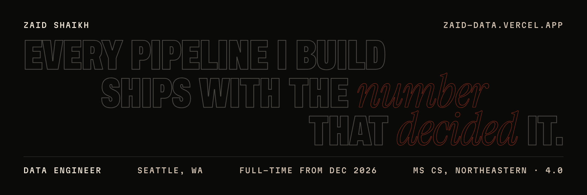
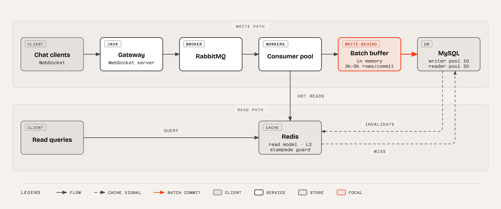
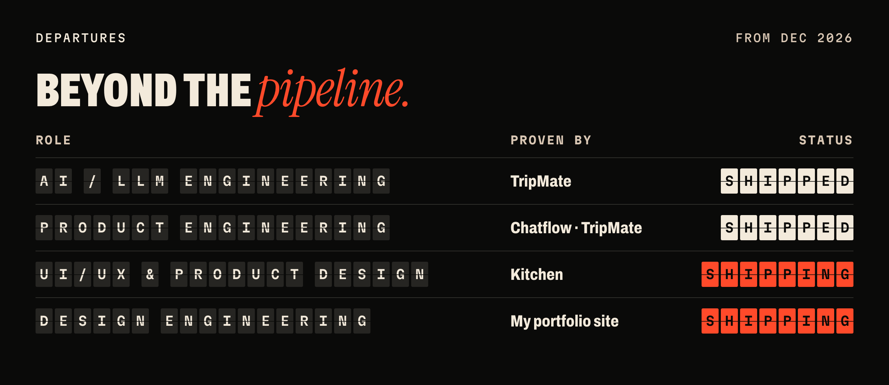
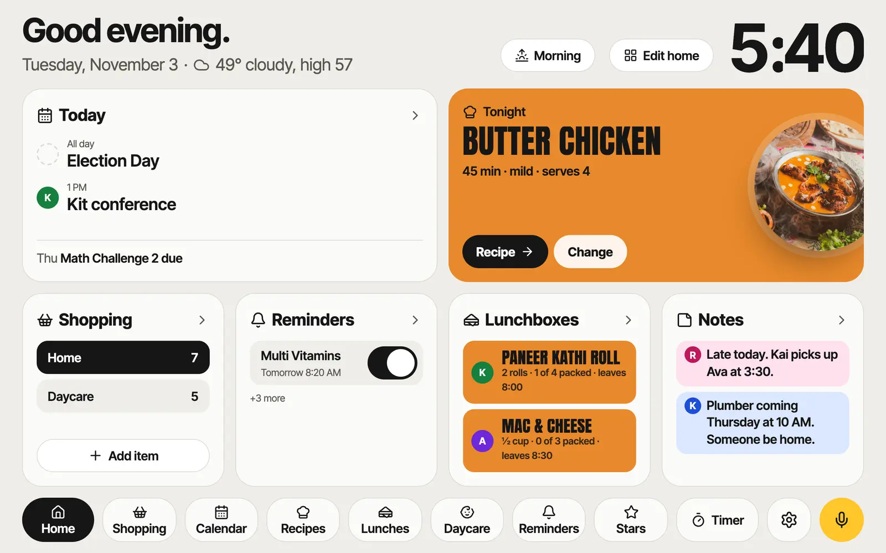
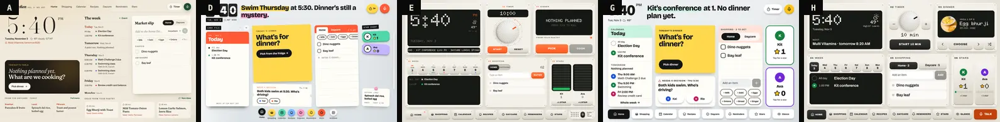
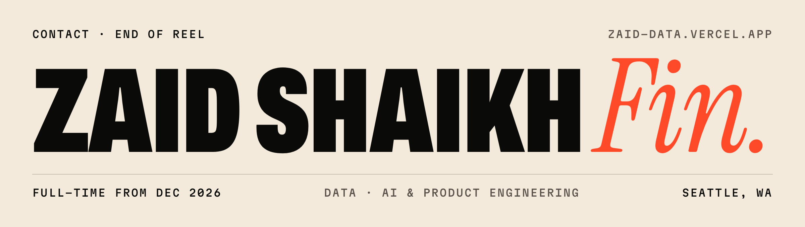

<a href="https://zaid-data.vercel.app/">
  <picture>
    <source media="(prefers-reduced-motion: reduce)" srcset="assets/hero.png">
    
  </picture>
</a>

[**Portfolio ↗**](https://zaid-data.vercel.app/) · [**Résumé ↗**](https://zaid-data.vercel.app/Zaid-Shaikh-Resume.pdf) · [**Email ↗**](mailto:shaikh.zaid@northeastern.edu) · [**LinkedIn ↗**](https://www.linkedin.com/in/zaidshaikhengineer/)

Data engineer who also builds AI products. MS Computer Science at Northeastern, December 2026, 4.0 GPA.
Open to full-time roles in data engineering and AI & product engineering from December 2026.

&nbsp;

## `01` &nbsp;Proof

A number on its own is a claim. Each of these says how it was taken.

| | |
|:--|:--|
| **21,091 msg/s**   `SUSTAINED THROUGHPUT` | A batch-size experiment showed per-commit overhead dominating MySQL writes: **~2,000 msg/s** at 100-row batches, **~10,000** at 5,000. Write-behind persistence with adaptive batching carried that to 21,091 msg/s on EC2, **99.98% persisted** across 1M messages. |
| **400 clients**   `LIVE FAN-OUT, 0 LOST` | Highest WebSocket step tested, every client at delivery ratio 1.000, **p95 166 ms** exchange-to-client. Across a Flink TaskManager kill, a Kafka restart and 30 s Postgres and Redis outages: **0 trades lost, 0 inconsistent candles**. |
| **2 of 5**   `HYPOTHESES REFUTED` | Written down before any transformation ran, over 9,660,252 Medicare claims. The dashboard publishes the two failures, and a "+2,223% premium" resting on **11 providers** ships with a `thin sample` badge instead of as a finding. |

&nbsp;

## `02` &nbsp;Work

### [Chatflow](https://github.com/DiazSk/Chatflow-Messaging-System) &nbsp;·&nbsp; real-time messaging infrastructure

`BACKEND` · **21,091 msg/s sustained · 13 ms reads at 1M rows · 99.98% persisted**

Per-commit overhead dominated MySQL writes, so persistence is write-behind: a buffer absorbs broker bursts at
memory speed and commits 500, 2K or 3K rows at a time, sized by queue depth. 5,000-row batches were faster in
the experiment, but the OOM killer stopped them on a t3.small, so production caps at 3,000. CQRS keeps the read
model in Redis, so a stalled write never blocks a query.

<b>Architecture</b>

<picture>
  <source media="(prefers-color-scheme: dark)" srcset="assets/diagrams/chatflow-dark.png">
  
</picture>

`Java` `RabbitMQ` `Redis` `MySQL` `HikariCP` `WebSockets` `AWS EC2`

### [Medicare Reimbursement Gap Analyzer](https://github.com/DiazSk/healthcare-lakehouse-azure) &nbsp;·&nbsp; lakehouse with in-browser SQL

`DATA ENGINEERING` · **9.66M claims · 231 s medallion run on a laptop · no backend**

Pre-aggregating the Gold marts made one panel **41% wrong while still looking plausible**: a cube cannot
reproduce a row-level filter. A parity gate now re-derives every panel from the fact table and fails the build
on disagreement. The same pass caught two of the 13 quality assertions that could never fail, because a `NULL`
inside `isin("F","O",None)` makes the predicate `NULL` for every row. Tiered Parquet is read client-side by
DuckDB-WASM over HTTP range requests. 108 automated tests.

<b>Architecture</b>

<picture>
  <source media="(prefers-color-scheme: dark)" srcset="assets/diagrams/medicare-dark.png">
  
</picture>

`PySpark 3.5` `Delta Lake` `Azure Databricks` `Azure Data Factory` `ADLS Gen2` `Terraform` `DuckDB-WASM`

### [Real-Time Crypto Analyzer](https://github.com/DiazSk/Real-Time-Cryptocurrency-Market-Analyzer) &nbsp;·&nbsp; streaming market terminal

`SYSTEMS` · **17,969 trades, 0 duplicates, 0 missed · 400 clients, 0 lost trades**

Every trade for 8 Coinbase pairs, deduplicated on trade ID and rolled into 1-minute candles in **event time**
with an EWMA z-score detector on top. Each sink carries a different guarantee on purpose: JDBC insert-or-skip,
transactional Kafka alerts per 30 s checkpoint, at-least-once Redis with client dedupe. Chaos testing found a
real bug: the API's pub/sub listener died on redis-py's own `ConnectionError`, so live trades never resumed after
a Redis restart. Fixed, and covered by a test. REST p95 **12.8 ms** at 1,640 req/s.

<b>Architecture</b>

<picture>
  <source media="(prefers-color-scheme: dark)" srcset="assets/diagrams/crypto-dark.png">
  
</picture>

`Python` `Kafka` `Flink (Java)` `TimescaleDB` `Redis` `dbt` `Airflow` `FastAPI` `Next.js` `Docker`

### [TripMate](https://github.com/DiazSk/tripmate) &nbsp;·&nbsp; AI trip planner for web and iPhone

`FULL-STACK · AI` · **108 s → 41 s median story latency, found in the traces**

Plans each day against data fetched for the actual dates (forecast, public holidays, OpenStreetMap opening
hours). Every model call goes through one dispatcher that writes a trace row on every outcome. Those traces
showed the CLI making a background model call on 87 of 88 requests; removing it, plus a 2,048-token thinking
budget, took story scripts from 108 s to 41 s. Answers can't name a place that was never fetched: one unknown
evidence id replaces the whole answer with "nothing checked". 2,508 automated tests; MapLibre picked over Cesium
by measurement, **3.4× fewer draw calls**.

<b>Architecture</b>

<picture>
  <source media="(prefers-color-scheme: dark)" srcset="assets/diagrams/tripmate-dark.png">
  
</picture>

`TypeScript` `Next.js 16` `React 19` `Expo` `SQLite (libsql)` `Claude API` `MapLibre GL` `WebGPU`

#### Also shipped

| | |
|:--|:--|
| **2.8M** clean records | [**NYC Taxi Data Lakehouse**](https://github.com/DiazSk/NYC-Taxi-Data-Lakehouse) · 100 GB batch pipeline on AWS. Athena bills per TB scanned, so Glue cleans **once at ingest** and the clean layer becomes a guaranteed fact for dbt. 96.8% retention through quality gates. |
| **109.8M** real events | [**E-commerce Funnel Lakehouse**](https://github.com/DiazSk/ecommerce-funnel-lakehouse) · Black Friday lifted cart reach 9.2% → **11.7%**, but a four-day tracking gap (468,262 carts, zero purchases) reverses every headline result if left in. Found, measured, excluded, and now guarded by a dbt test. |
| **90%** lower latency | [**Olist Data Warehouse**](https://github.com/DiazSk/sql-data-warehouse-project) · A strict star schema with **two grain-specific fact tables**: one grain, one join path, no double counting. 14 source systems, 1.6M+ records. |

&nbsp;

## `03` &nbsp;Beyond the pipeline

Data engineering is the job I'm going for first. I also build the products around the data, and lately I design
them too.

| Role | Proven by | Status |
|:--|:--|:--|
| AI / LLM engineering | [TripMate](https://github.com/DiazSk/tripmate): checks its plan against real forecast, holiday and opening-hours data, every model call traced | Shipped |
| Product engineering | Chatflow · TripMate: a 21,091 msg/s messaging system and an AI planner in Next.js | Shipped |
| UI/UX & product design | Kitchen, below | Shipping |
| Design engineering | [zaid-data.vercel.app](https://zaid-data.vercel.app/): explored through dozens of directions in MagicPath, built into one system with Claude Code | Shipping |

### Kitchen &nbsp;·&nbsp; a family's kitchen-tablet app

`UI/UX · PRODUCT DESIGN` · **8 Home directions · 63 revisions on the one I chose · 13 screens redesigned, 3 new · 4 viewports × day and night**

Calm Wall · the Home it became (demo data, names changed)

Five of the eight directions I explored first · A Morning Market · D Fridge Door 2.0 · E Appliance · G Magnet Board · H Appliance (principled)

**Chose** Calm Wall: one quiet Home that answers "what's next?" at a glance, with the clock, today, tonight's dinner and the family's lists each in its own card.

**Over** seven louder directions I designed first, from an editorial page to fridge doors, a magnet board and retro appliance panels.

**Because** the tablet hangs on a kitchen wall. It is read from 2–3 m and touched with wet or messy hands, so the clock and the next thing due have to carry across the room, and every control needs a 48 px target with space around it.

- Wrote the UX rules before the screens: a six-step type scale from 14 to 96 px, 48 px minimum targets, one job per colour, 4.5:1 contrast, and a 5-second Undo on every check-off, timer stop and star.
- Split the wall into two zones: a Glance view with no controls for reading across the room, and the Touch board for arm's length.
- Rebuilt every screen in code in one pull request, adding school lunches, a Morning board and a Family board, then checked every route at four viewports in day and night themes.

`MagicPath` `Claude Code` `Next.js` `React` `TypeScript` `Tailwind CSS` `Framer Motion` `Postgres`

&nbsp;

## Stack

The core I reach for, by layer.

| | |
|:--|:--|
| `LANGUAGES` | Python · Java · SQL · TypeScript |
| `STREAMING & MESSAGING` | Kafka · Flink · RabbitMQ · WebSockets |
| `COMPUTE & TRANSFORM` | Spark · Databricks + Delta Lake · dbt |
| `STORAGE & WAREHOUSE` | Snowflake · PostgreSQL · DuckDB · MySQL |
| `ORCHESTRATION & INFRA` | Airflow · Docker · Terraform · AWS · Azure |
| `APPS & AI` | Next.js · Claude API |

## Experience

**Research Co-author, The Laundering Effect** · Khoury College, Northeastern · Fall 2025 – present · `COLM 2026, UNDER REVIEW` 
Measuring cumulative semantic erosion under iterative LLM paraphrasing across 36,800+ records, with a composite
Semantic Drift Score (SBERT / METEOR / ROUGE-L) that surfaces degradation single-step metrics miss.

**Graduate Teaching Assistant, Machine Learning (CS6140)** · Khoury College, Northeastern · May 2026 – present 
Weekly office hours debugging student implementations of PCA, regression and regularization; grading model code
and written analyses.

&nbsp;

[**shaikh.zaid@northeastern.edu**](mailto:shaikh.zaid@northeastern.edu) · [**LinkedIn**](https://www.linkedin.com/in/zaidshaikhengineer/) · [**zaid-data.vercel.app**](https://zaid-data.vercel.app/)
